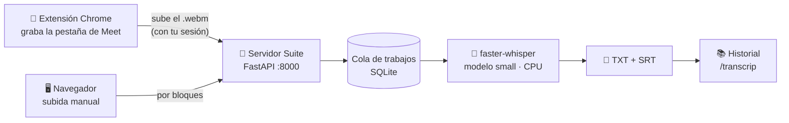

<div align="center">

# 🎙️ Suite · Transcrip

**Grabá tus reuniones de Google Meet desde Chrome y transcribilas en tu propio servidor.**
Sin nubes de terceros, sin APIs pagas: todo corre en un contenedor Docker.


</div>

---

## ✨ Qué hace

- **Transcrip**: subís un video o audio (o lo manda la extensión) y obtenés la transcripción en **TXT** y **SRT**, con historial de trabajos.
- **Transcrip Recorder**: extensión de Chrome que graba el audio de una pestaña (Meet, Zoom web, un video…) y lo sube al servidor al cortar.
- **MarkItDown**: convierte PDF, Office, HTML, imágenes, etc. a Markdown.
- Login de un usuario administrador. Transcripción con [faster-whisper](https://github.com/SYSTRAN/faster-whisper) en CPU (int8).



## 📋 Requisitos

| Recurso | Mínimo razonable | Notas |
|---|---|---|
| Docker | Docker Engine + Compose v2 | Linux, macOS o Windows (Docker Desktop) |
| CPU | 2 núcleos (4+ recomendado) | En CPU, `small` int8 tarda del orden de 0,5–1× la duración del audio con 4 núcleos (estimado; depende del hardware) |
| RAM | 2 GB libres (4 GB recomendado) | `small` en int8 usa ~1 GB; más si pasás a `medium` |
| Disco | ~3 GB + tus grabaciones | Imagen (~2 GB) + modelo `small` (~500 MB) + videos y transcripciones |

## 🚀 Quick start

```bash
# 1. Clonar
git clone <url-de-este-repo> suite && cd suite

# 2. Configurar
cp .env.example .env
#    completá SUITE_ADMIN_PASSWORD y SUITE_SESSION_SECRET. Para el secreto:
python -c "import secrets; print(secrets.token_urlsafe(48))"
#    (o: openssl rand -base64 48)

# 3. Levantar
docker compose up -d --build

# 4. Abrir http://localhost:8000 y entrar con SUITE_ADMIN_USER / SUITE_ADMIN_PASSWORD
```

La primera transcripción tarda más: descarga el modelo whisper y lo deja cacheado en `./data/models`.

## ⚙️ Variables (`.env`)

| Variable | Obligatoria | Default | Para qué |
|---|:---:|---|---|
| `SUITE_ADMIN_PASSWORD` | ✅ | — | Clave del admin. Texto plano o hash bcrypt (`$2…`) |
| `SUITE_SESSION_SECRET` | ✅ | — | Firma la cookie de sesión. Cadena larga y aleatoria |
| `SUITE_PUBLIC_URL` | recomendada | `http://localhost:8000` | URL con la que se llega al servidor. **Se inyecta en la extensión** al descargarla |
| `SUITE_PORT` | | `8000` | Puerto publicado en el host |
| `SUITE_ADMIN_USER` | | `admin` | Usuario del login |
| `SUITE_APP_NAME` | | `Suite` | Nombre en la interfaz |
| `SUITE_MODEL` | | `small` | Modelo whisper: `tiny`, `base`, `small`, `medium`, `large-v3` |
| `SUITE_LANGUAGE` | | `es` | Idioma de la transcripción |
| `SUITE_COMPUTE_TYPE` | | `int8` | Precisión de cómputo (int8 = rápido en CPU) |
| `SUITE_DEVICE` | | `cpu` | `cpu` o `cuda` (GPU requiere imagen y runtime con CUDA) |
| `SUITE_JOB_CONCURRENCY` | | `1` | Transcripciones en paralelo |
| `SUITE_MAX_UPLOAD_GB` | | `10` | Tamaño máximo de video |
| `SUITE_MARKITDOWN_MAX_UPLOAD_MB` | | `512` | Tamaño máximo para MarkItDown |
| `SUITE_CHUNK_SIZE_MB` | | `16` | Tamaño de bloque de la subida manual |
| `SUITE_RETENTION_DAYS` | | vacío (nunca) | Días hasta borrar el video original (las transcripciones quedan) |
| `SUITE_GOOGLE_DOCS_ENABLED` | | `false` | 🧪 Experimental: botón "Abrir en Google Doc" |
| `SUITE_GOOGLE_SERVICE_ACCOUNT_KEY` | | `/data/google-service-account.json` | 🧪 JSON de service account (ruta dentro del contenedor) |

Los datos viven en `./data` (SQLite, videos, transcripciones, cache del modelo). Para backup, copiá esa carpeta.

## 🧩 Instalar la extensión de Chrome

1. En la Suite → **Transcrip** → **Extensión Chrome (.zip)** (o `GET /extension/transcrip-recorder.zip`). Descomprimilo en una carpeta fija: Chrome la sigue usando, no la borres.
2. Abrí `chrome://extensions` y activá **Modo de desarrollador** (arriba a la derecha).
3. Tocá **Cargar descomprimida** y elegí la carpeta `transcrip-recorder`.
4. Fijala en la barra, iniciá sesión en la Suite en ese mismo Chrome y, desde la pestaña de Meet, tocá **Grabar**.

**¿Cómo sabe a qué servidor apuntar?** El servidor arma el zip al vuelo e inyecta `SUITE_PUBLIC_URL` en el `manifest.json` (`host_permissions`, `content_scripts`) y en `background.js`. Por eso `SUITE_PUBLIC_URL` tiene que ser la URL **exacta** que usás en el navegador. Si la cambiás, volvé a bajar el zip. (Cargar la carpeta `extension/` del repo tal cual apunta a `http://localhost:8000`.)

## 🔒 HTTPS (opcional)

El contenedor sirve HTTP plano. Para exponerlo fuera de tu máquina poné delante un reverse proxy propio. Ejemplo con [Caddy](https://caddyserver.com/) (certificado automático):

```caddyfile
suite.tudominio.com {
    reverse_proxy localhost:8000
    request_body {
        max_size 10GB
    }
}
```

Y en `.env`: `SUITE_PUBLIC_URL=https://suite.tudominio.com`. Con `https`, la cookie de sesión se marca `Secure`.

## 🔄 Actualizar

```bash
git pull
docker compose up -d --build
```

El código se hornea en la imagen: cualquier cambio necesita `--build`. Tus datos en `./data` no se tocan. Si cambió la extensión, bajá el zip nuevo, reemplazá la carpeta y tocá ↻ en `chrome://extensions`.

## 🛠️ Troubleshooting

| Síntoma | Causa / solución |
|---|---|
| `CRX_REQUIRED_PROOF_MISSING` al instalar | Chrome bloquea los `.crx` que no vienen de la Web Store. Por eso la extensión se distribuye como **zip para "Cargar descomprimida"**. Si tenías un `.crx` viejo, quitalo primero |
| La extensión abre el login una y otra vez | No hay sesión para la URL de `SUITE_PUBLIC_URL`. Entrá a la Suite con **esa** URL exacta (mismo host y esquema) en el mismo Chrome |
| "No se pudo conectar al servidor" | `SUITE_PUBLIC_URL` no coincide con cómo llega Chrome al servidor, o el zip es anterior al cambio. Corregí y volvé a bajarlo |
| `Falta SUITE_ADMIN_PASSWORD en .env` | No copiaste `.env.example` a `.env` o dejaste vacías las obligatorias |
| La primera transcripción "no arranca" | Está descargando el modelo. Mirá `docker compose logs -f suite` |
| Muy lento | Normal en CPU. Probá `SUITE_MODEL=base` o más núcleos; dejá `SUITE_JOB_CONCURRENCY=1` |
| Subidas grandes cortadas detrás del proxy | Subí el límite de body del proxy (ver ejemplo de Caddy) |

## 🧪 Experimental: "Abrir en Google Doc"

**Apagado por defecto y sin garantía de funcionar** (en pruebas devolvió 403 de la API de Google). Crea un Google Doc con el SRT usando una service account. Para probarlo: creá una service account con las APIs Docs y Drive habilitadas, dejá su JSON en `./data/google-service-account.json` y poné `SUITE_GOOGLE_DOCS_ENABLED=true`. ⚠️ Es la **única** función que manda datos afuera, y el doc queda compartido como editable para cualquiera con el link.

## 🔐 Privacidad

- La transcripción corre **en tu servidor**: el audio no sale a ninguna API externa.
- Lo único que se baja de internet es el modelo whisper (una vez, desde Hugging Face).
- Grabaciones, transcripciones y base quedan en `./data`, que **no** se versiona (`.gitignore`).
- Avisá a los participantes antes de grabar una reunión.

## 📁 Estructura

```
.
├── docker-compose.yml
├── .env.example
├── server/        # FastAPI + faster-whisper + MarkItDown (imagen Docker)
└── extension/     # Transcrip Recorder (Chrome MV3)
```
